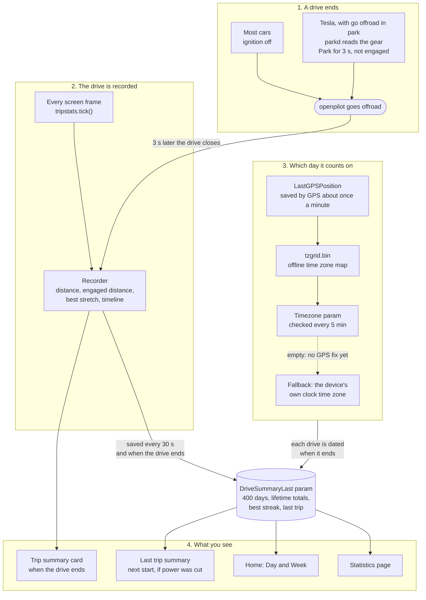

# Porting trip stats and Park-offroad

Trip stats keeps a record of your driving on the comma. It works on any car. Park-offroad is the Tesla part: it ends the drive when you shift into Park, because a Tesla has no ignition to turn off.

## What you see

- **Trip summary card.** When a drive ends, a card shows the distance, how much of it openpilot drove, your day streak, your best engaged stretch and a timeline in comma connect's colors. It stays up for 20 seconds or until you tap it.
- **Day and Week on Home.** Today's and this week's distance and percent engaged. Tap the row to open Statistics.
- **Statistics.** Weekly and monthly charts, lifetime totals and your best streak.
- **Last trip summary.** If the comma lost power before the card could show, the card comes up once at the next start with the headline "last trip summary".

## How a drive becomes a stat

The screen code calls the recorder on every frame. While you drive, it adds up the distance, the distance openpilot was engaged, the longest engaged stretch and a timeline. It saves the drive every 30 seconds, so a power cut loses at most 30 seconds of driving.

The drive ends 3 seconds after openpilot goes offroad. The short wait keeps a quick on-off blip from splitting one drive into two. The drive is then added to its day, and the card comes up if the car has stopped and the trip was at least 0.1 mi and 30 seconds long.

Everything is kept in one param, `DriveSummaryLast`: 400 days of daily totals, plus lifetime totals, the best stretch, the best streak and the last trip. Home, the card and Statistics all read from it, so they always agree. There are no extra files and no extra processes.



## How "today" is decided

Day resets at midnight and Week resets at the start of the local week, in the local time where the car is. The comma works this out from GPS, with no internet needed:

1. GPS saves the car's last position about once a minute (`LastGPSPosition`).
2. A small built-in time zone map, `tzgrid.bin`, turns that position into a zone such as `America/Chicago`.
3. The zone is saved in the `Timezone` param. This is checked every 5 minutes.
4. Until there is a GPS fix, the comma uses its own clock's time zone.

Week starts on the day weeks start in that country: Sunday in places like the US, Canada, Mexico and Japan, Monday in most of Europe, Australia and China, and Saturday in much of the Middle East. Until the comma knows its zone, Week starts Sunday. That list is `weekstart.json`.

The zone can't be set by hand. Within about 5 km of a zone border, the map can pick the zone next door.

A drive counts on the day it ends. Each drive is saved with the time zone offset at that moment, so driving into a new zone never moves old drives. If the comma's clock is wrong at start-up, a drive waits until the clock is corrected, so it is never filed on the wrong day.

## Why Tesla needs Park logic

On most cars, turning off the ignition takes openpilot offroad. That ends the drive and brings up the card. Trip stats needs nothing more.

A Tesla has no ignition switch. The car stays awake in Park, so openpilot stays onroad and the drive never ends. Park-offroad fixes that. A small process, `parkd`, reads the gear from the car. Once the car has been in Park for 3 seconds and openpilot is not engaged, the comma goes offroad the normal way. The card comes up as soon as you shift into Park. Shifting to R or D starts a new drive. Park-offroad only reads the gear. It sends nothing to the car and doesn't change panda safety.

Other cars that stay awake without a normal ignition may need their own version. We don't know which ones they are. To add one, write a decoder for its gear or power signal and add a `ParkSource` to `PARK_SOURCES` in `park_offroad.py`. Nothing in trip stats changes. Contributions are welcome.

## Port trip stats in one command

Run this in your fork, on a branch close to comma master:

```
git fetch https://github.com/Memberoffoxhound/openpilot port/tripstats && git cherry-pick FETCH_HEAD
```

`port/tripstats` is a single commit on top of comma master `0152aab` (Oct 29, 2026). It adds:

- `selfdrive/ui/tripstats/`: the module, its tests, `tzgrid.bin` and `weekstart.json`
- `common/params_compat.py`
- the card and the Day / Week row (`mici/widgets/drive_summary_card.py`, `trip_row.py`)
- the Statistics page (`mici/layouts/settings/stats.py`), with a button in Settings
- small hooks in `mici/layouts/main.py`, `mici/onroad/augmented_road_view.py`, `mici/layouts/home.py` and `mici/layouts/settings/settings.py`
- a "drive summary" toggle in `mici/layouts/settings/toggles.py`
- three params in `common/params_keys.h`: `DriveSummary`, `DriveSummaryLast` and `Timezone`

Turn on "drive summary" in Toggles. The Day / Week row takes the line on Home that showed the commit hash.

If your fork has changed those UI files, the cherry-pick stops with conflicts in the hook files. The module files are all new, so they never conflict. Fix the hooks by hand, run `git cherry-pick --continue`, and check it with:

```
pytest openpilot/selfdrive/ui/tripstats openpilot/selfdrive/ui/tests/test_drive_summary.py
```

The params go through `params_compat.py`. A device whose params library was built before the new keys existed reads and writes the raw param files instead, so nothing breaks before the next build.

Highland's web page is not part of the port. Its tests skip when it isn't there.

`tzgrid.bin` is built by `build_tzgrid.py` from [timezone-boundary-builder](https://github.com/evansiroky/timezone-boundary-builder) data, © OpenStreetMap contributors, under the [ODbL 1.0](https://opendatacommons.org/licenses/odbl/1-0/). Keep that credit if you ship the file. `weekstart.json` is built by `build_weekstart.py` from [Unicode CLDR](https://cldr.unicode.org/) data (© Unicode, Inc., [Unicode License v3](https://www.unicode.org/license.txt)) and the tz database's `zone.tab`.

`selfdrive/ui/tripstats/README.md` has the store format and the edge cases.

## Port Park-offroad (Tesla)

Park-offroad isn't in the command above, because it reaches into hardwared and the manager, which forks change more often. Copy `selfdrive/car/park_offroad.py` and `selfdrive/ui/lib/park_view.py`, then add these pieces:

- Params: `{"ParkOffroad", {PERSISTENT, BOOL, "0"}}` and `{"ParkOffroadState", {CLEAR_ON_MANAGER_START, INT, "0"}}`. Don't give the state `CLEAR_ON_IGNITION_ON`, because an `ignitionCan` blip would drop the latch.
- hardwared: `onroad_conditions["not_parked"] = park_offroad.not_parked(params)`. After `off_ts` is set, add `off_ts = park_timer.update(onroad_conditions["not_parked"], started_ts is not None, onroad_conditions["ignition"], off_ts, time.monotonic())` with `park_timer = park_offroad.OffroadTimer()`, so time sitting in Park doesn't count toward shutdown.
- process_config: `PythonProcess("parkd", "openpilot.selfdrive.car.park_offroad", park_offroad.should_run, enabled=not PC)`. Highland uses its own `RestartingPythonProcess` here, which restarts parkd if it dies.
- ui_state: `self.park = ParkView()`, updated every frame with `park_offroad.get_state(params)`. The brightness code holds the onroad level while the card is up in Park (`ui_state.park.brightness`).
- main layout: start the card at the first Park sample with `elif ui_state.park.parked and not self._prev_parked: self._summary.begin()`, and clear it only when `ui_state.ignition and not parked`.
- road view: render the card onroad too, since it comes up before the device goes offroad, and show "shift to D or R" instead of "can't start" while parked.
- A toggle for `ParkOffroad`. Highland's "go offroad in park" also turns on `DriveSummary`.

The tests are `selfdrive/car/tests/test_park_offroad.py` and `selfdrive/ui/tests/test_park_view.py`. The first one also covers Highland's `tesla_step_aside`, so drop those cases if you don't take it.
