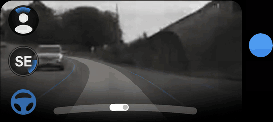
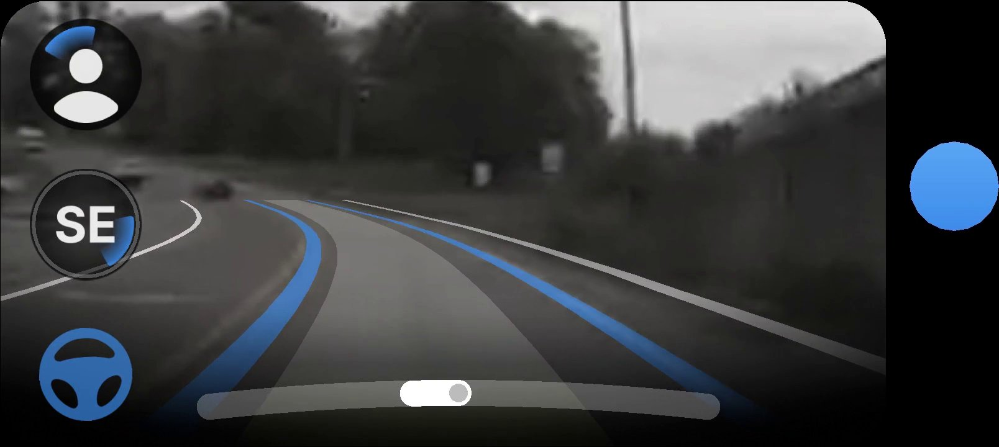
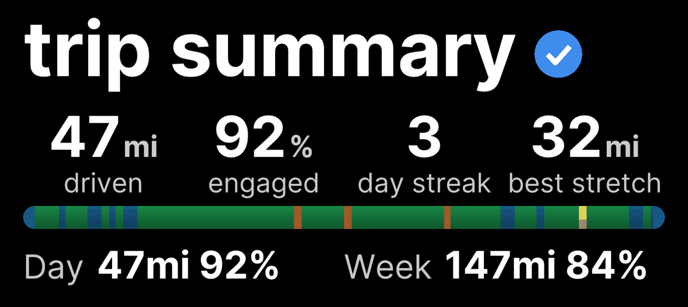
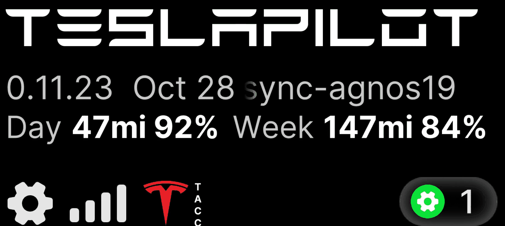
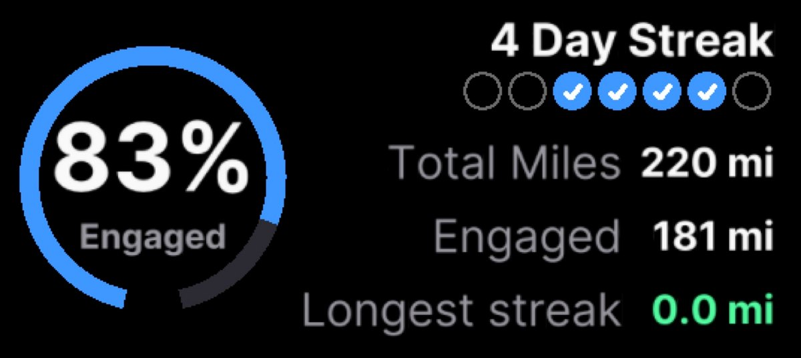
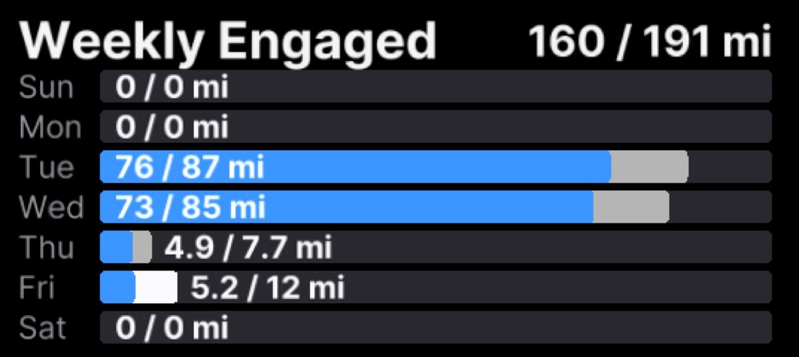
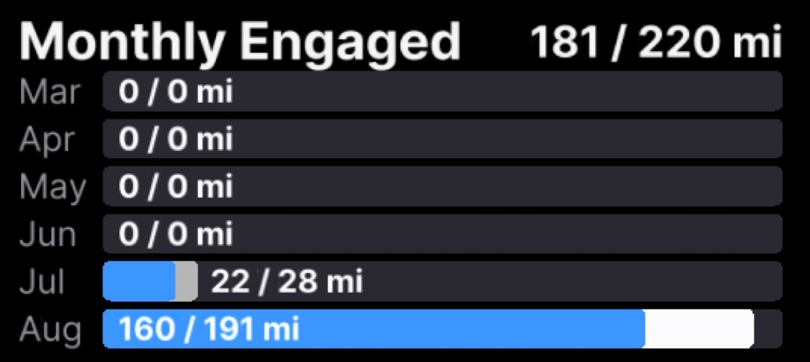

# TeslaPilot

TeslaPilot is a hobby fork of [comma.ai openpilot](https://github.com/commaai/openpilot) for **stalkless Tesla Model 3 Highland** cars. It adds Tesla-friendly controls, a Tesla-style theme, on-device drive stats, and a local web page for your comma.

It is one person's project. There is no support, and you install it at your own risk.



> **Highland Teslas only.** The car is always identified as a 2025 Tesla Model 3 (`TESLA_MODEL_3`). Don't install it on pre-Highland Teslas or other makes.

## What you need

- A **comma 4**. TeslaPilot is built and tested only on a comma 4.
- **AGNOS 19.7.** TeslaPilot stays on AGNOS 19, so installing it doesn't flash a new OS.
- A **Tesla Model 3 Highland** with the Tesla B harness. It's driven daily on a 2026 Model 3 Highland.

The version is **0.11.23**, based on comma openpilot 0.11.2 and synced with comma master.

## Install

On the comma's setup screen, pick **Custom Software** and enter:

```
installer.comma.ai/Memberoffoxhound/Highland
```

The branch name is case-sensitive. To go back to stock openpilot, use `openpilot.comma.ai`.

`Highland` is the main install branch. New features are tested on `jetlink-sync-agnos19` first.

## What's different from openpilot

### Engage with the scroll wheel

Credit: stalkless cancel by [dkiiv](https://github.com/dkiiv) ([commaai/opendbc#3203](https://github.com/commaai/opendbc/pull/3203)), ported through [dzid26](https://github.com/dzid26)'s Tesla fork.

Stalkless Teslas have no cruise stalk. Press the **right scroll wheel** to engage or disengage.

### Cooperative steering

Credit: [dzid26](https://github.com/dzid26)'s cooperative steering ([dzid26/sunnypilot](https://github.com/dzid26/sunnypilot), `vtb-sla`), and [AmyJeanes](https://github.com/AmyJeanes)' Tesla coop steering in sunnypilot ([sunnypilot/opendbc#287](https://github.com/sunnypilot/opendbc/pull/287)).

You can nudge the wheel while engaged and openpilot steers with you instead of fighting you. A firm hand on the wheel still disengages.

### Newer Tesla firmware fix

Credit: [AmyJeanes](https://github.com/AmyJeanes) ([commaai/opendbc#3389](https://github.com/commaai/opendbc/pull/3389)).

Reads Tesla's steering-control message correctly on newer firmware, so stock lane keeping isn't mistaken for FSD.

### Auto lane change

Credit: [rav4kumar](https://github.com/rav4kumar)'s automatic lane change in sunnypilot ([sunnypilot/sunnypilot#653](https://github.com/sunnypilot/sunnypilot/pull/653)), with [Jason Wen / sunnyhaibin](https://github.com/sunnyhaibin).

Off by default (**Settings → toggles → auto lane change**). When it's on, the blinker starts a lane change without a wheel nudge, above 25 mph and once Tesla's blind-spot monitor says the lane is clear.

### Step aside for Tesla FSD

On by default. If Tesla Autosteer, FSD, or Summon is selected or active, TeslaPilot stays out of the way and sends nothing to the car. It comes back once you're on TACC again.

### Tesla theme

**Settings → theme**:

- **onroad UI**: stock comma view or the custom view with a compass.
- **compass size**: small or large.
- **theme**: Tesla Autopilot blue (default) or openpilot green.



### Drive stats, kept on your device

Your drive stats stay on the comma. Nothing is uploaded. To turn them on, use **Settings → toggles → go offroad in park** (why it's needed on a Tesla is explained below).

**Trip summary card.** When a drive ends, a card shows the distance, percent engaged, day streak, best engaged stretch, and a timeline of the drive in comma connect's colors. It stays up for 20 seconds or until you tap it, then the screen moves to Home. Swipe back to see it again until your next drive.



**Day and Week on Home.** Home shows today's and this week's distance and percent engaged. Tap the row to open **Statistics**, which you can also find in **Settings → statistics**.



| Engaged | Weekly | Monthly |
|:---:|:---:|:---:|
|  |  |  |

**How a drive is counted.** The comma saves the drive in progress every 30 seconds. If it loses power, the drive is kept up to that point, and the card comes up once at the next start as "last trip summary".

**What counts as today.** Day resets at midnight and Week resets on Sunday, in the local time where the car is. The comma finds its time zone from GPS, using a built-in map, so it works offline. Until it has a GPS fix, it uses its own clock's time zone. A drive counts on the day it ends, and driving into a new time zone never moves old drives.

**Ending a drive on a Tesla.** A Tesla has no ignition to turn off, so openpilot would stay onroad in Park. With **go offroad in park** on, when you shift into Park, the card comes up and the comma goes offroad. Shifting to R or D starts a new drive.

The badge in Home's footer shows which system controls gas and brake:

| | |
|:---:|:---|
|  | **TACC**: Tesla controls gas and brake, and openpilot steers. |
|  | **LONG**: openpilot controls gas and brake (alpha, **Settings → developer → alpha longitudinal**). |

### Web page on your comma

Open `http://<comma-ip>:8089` from a phone or computer on the **same Wi-Fi or hotspot**. It shows drive stats, device health, and screenshots, and it can record the screen. It runs all the time, onroad and offroad. **It has no login**, so anyone on that network can open it.

To take a screenshot on the comma itself, hold your finger on the screen for 3 seconds. Screenshots are saved in `/data/media/0/screenshots`.

### Jetlink big model (optional)

Credit: [zoompilot/jetlink](https://github.com/zoompilot/jetlink), wired as in [zoompilot](https://github.com/zoompilot/zoompilot). The model picker is a cut-down port of [sunnypilot](https://github.com/sunnypilot/sunnypilot)'s model manager.

Runs openpilot's big driving model on a phone or computer plugged into the comma's USB-C port. Set it up in **Settings → models**. While it's off, nothing changes.

## Safety

TeslaPilot doesn't change driver monitoring, the excessive-actuation checks, or panda safety. [SAFETY.md](SAFETY.md) has the details and the CI checks that enforce them.

You are the driver. Keep your eyes on the road and your hands ready to take over.

**THIS IS ALPHA QUALITY SOFTWARE FOR RESEARCH PURPOSES ONLY. THIS IS NOT A PRODUCT. YOU ARE RESPONSIBLE FOR COMPLYING WITH LOCAL LAWS AND REGULATIONS. NO WARRANTY EXPRESSED OR IMPLIED.**

## Help and contributing

- Found a bug? [Open an issue](https://github.com/Memberoffoxhound/openpilot/issues) with your route ID from [comma connect](https://connect.comma.ai).
- Pull requests are welcome.
- To reuse the drive summary card or the park logic in your own fork, see [PORTING.md](PORTING.md).
- For general openpilot help, try the [comma Discord](https://discord.comma.ai) and the [openpilot docs](https://docs.comma.ai).

## Credits

TeslaPilot is built on the work of these people and projects. Thank you.

| Feature | Source | Link |
|---|---|---|
| Everything else | comma.ai openpilot, opendbc, panda | [commaai/openpilot](https://github.com/commaai/openpilot) |
| Scroll-wheel engage/cancel | dkiiv, via dzid26's Tesla fork | [commaai/opendbc#3203](https://github.com/commaai/opendbc/pull/3203) |
| Cooperative steering | dzid26 (`vtb` / `vtb-sla`) | [dzid26/sunnypilot](https://github.com/dzid26/sunnypilot) |
| Tesla coop steering in sunnypilot | AmyJeanes | [sunnypilot/opendbc#287](https://github.com/sunnypilot/opendbc/pull/287) |
| Newer-firmware steering fix | AmyJeanes | [commaai/opendbc#3389](https://github.com/commaai/opendbc/pull/3389) |
| Auto lane change | rav4kumar, with Jason Wen (sunnyhaibin), sunnypilot | [sunnypilot/sunnypilot#653](https://github.com/sunnypilot/sunnypilot/pull/653) |
| Jetlink big model | zoompilot | [zoompilot/jetlink](https://github.com/zoompilot/jetlink) |
| Model picker | sunnypilot model manager, as wired by zoompilot | [sunnypilot/sunnypilot](https://github.com/sunnypilot/sunnypilot) |
| TESLA font (wordmark) | KAYOver, based on TeslaNikolaCaps by Shane Milburn | [dafont](https://www.dafont.com/tesla.font) |
| Inter font | Rasmus Andersson | [rsms/inter](https://github.com/rsms/inter) |
| Time zone table (`tzgrid.bin`) | timezone-boundary-builder by Evan Siroky, from OpenStreetMap data | [evansiroky/timezone-boundary-builder](https://github.com/evansiroky/timezone-boundary-builder) |

## License

openpilot and TeslaPilot are released under the [MIT license](LICENSE). Some parts use other licenses:

- **TESLA font**: [CC BY-NC-SA 3.0](https://creativecommons.org/licenses/by-nc-sa/3.0/), non-commercial use only. See `openpilot/selfdrive/assets/fonts/TESLA-LICENSE.txt`.
- **Inter font**: [SIL Open Font License 1.1](https://openfontlicense.org).
- **Time zone table** (`openpilot/selfdrive/ui/tripstats/tzgrid.bin`): built from [timezone-boundary-builder](https://github.com/evansiroky/timezone-boundary-builder) data, © OpenStreetMap contributors, under the [Open Database License (ODbL) 1.0](https://opendatacommons.org/licenses/odbl/1-0/).

TeslaPilot isn't affiliated with Tesla, Inc. or comma.ai. The wordmark isn't Tesla's official logo.
